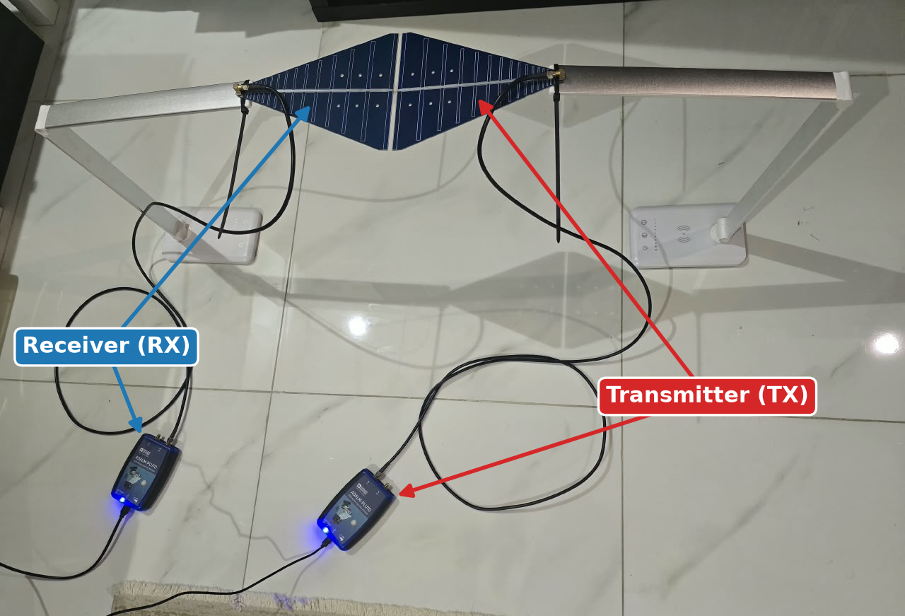
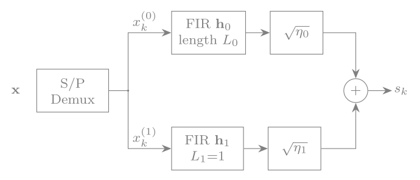
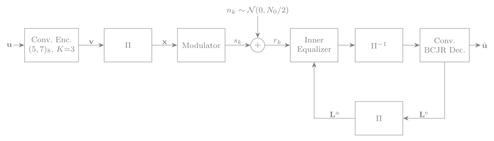
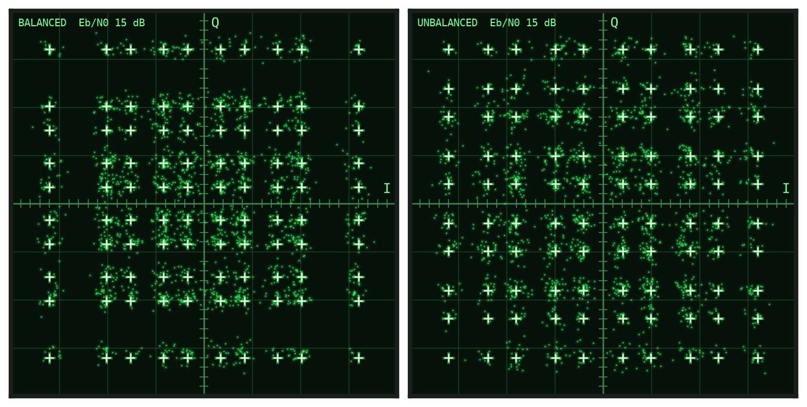
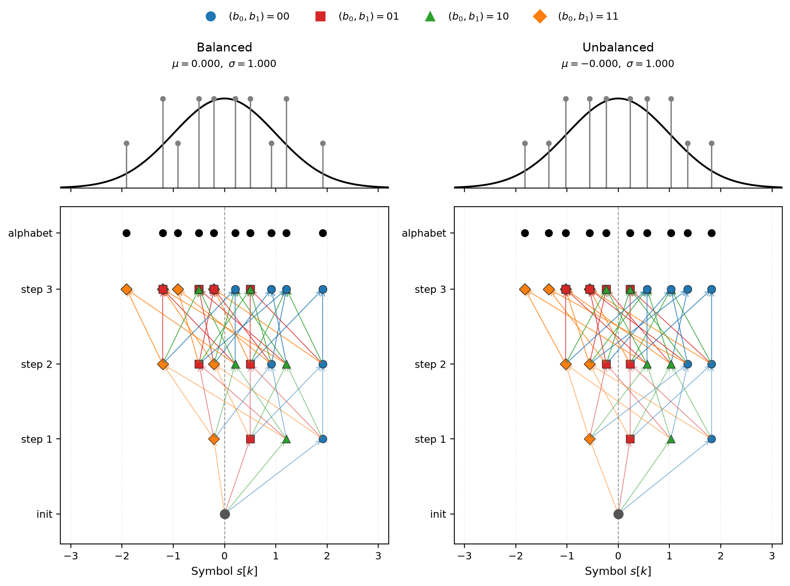
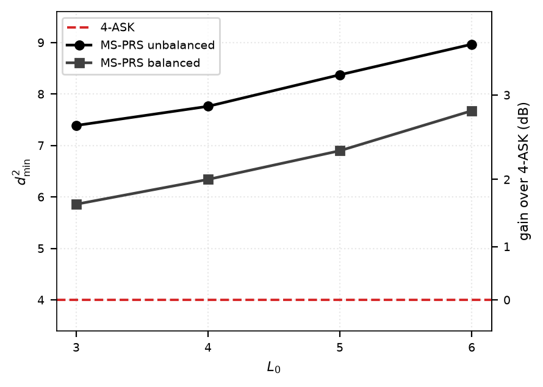
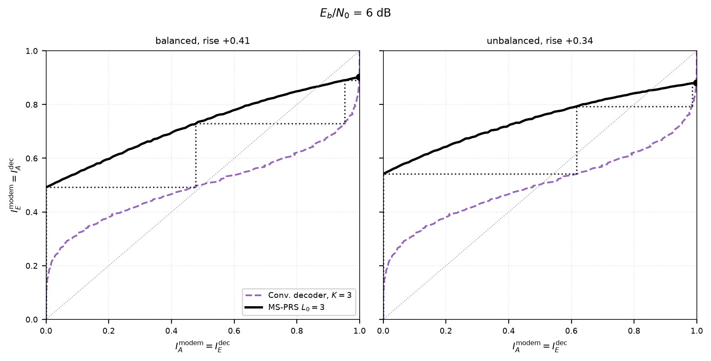
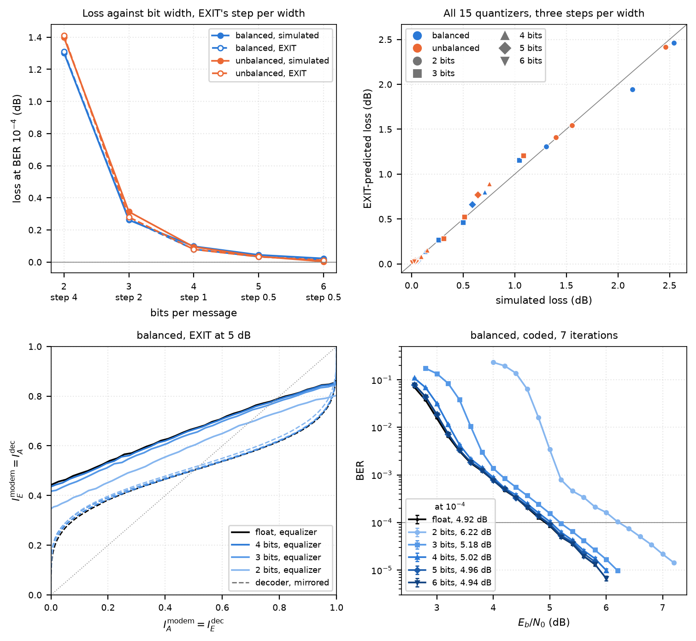
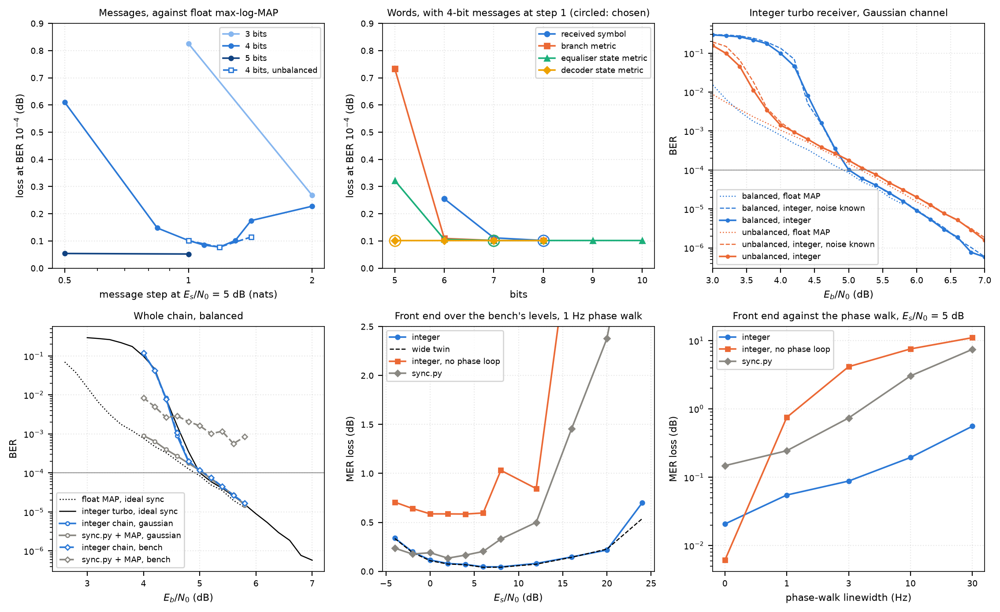

# Turbo-Equalized MS-PRS

**Multi-Stream Partial Response Signaling (MS-PRS)** is a modulation scheme at the Nyquist rate that adds controlled intersymbol interference through short FIR filters across two bipolar sub-streams, instead of compressing the symbol period the way faster-than-Nyquist signaling does. MS-PRS at Rate 2 carries two bits per channel use. This project uses [AFF3CT](https://github.com/aff3ct/aff3ct) for efficient BER simulations and tests the scheme over the air between two ADALM-Pluto software-defined radios.

The experimental setup: the transmitter (right) and the receiver (left) each
feed a log-periodic antenna, and the two antennas face each other. The link runs
at 448 MHz, and each radio has its own crystal.

<p align="center">
  
</p>

Inside the modulator, the interleaved bits split into two bipolar sub-streams. One runs through
an `L0`-tap FIR filter `h0`, which is where the controlled ISI comes from; the other passes a
single tap. The two are scaled and summed into one Nyquist-rate symbol, carrying two bits between
them. The gains set the energy split, `eta_0 + eta_1 = Es`: the balanced family divides it evenly,
the unbalanced family tilts it toward the single-tap stream.

<p align="center">
  
</p>

The chain the simulator runs: encode, interleave, modulate, then a receiver that passes extrinsic information between the equalizer and the decoder. The receiver is a turbo loop: a BCJR equalizer on the `2^(L0-1)`-state trellis trades log-likelihood ratios with a rate-1/2 convolutional or LDPC decoder.

<p align="center">
  
</p>

Both BCJRs, the equalizer's and the convolutional decoder's, run one of three
algorithms, chosen with `--bcjr`. MAP works on probabilities and is exact; it
is the default. log-MAP works on their logarithms and reads the Jacobian
correction from a table. max-log-MAP drops the correction. For `L0 = 3` with 7
iterations, balanced / unbalanced, on one thread of a Ryzen 5 3600X:

| `--bcjr` | Eb/N0 at BER 1e-3 | Eb/N0 at BER 1e-4 | Time per frame | Speed vs MAP |
|---|---|---|---|---|
| `map` (default) | 3.89 / 4.06 dB | 4.91 / 5.13 dB | 11.3 / 11.8 ms | 1.00 / 1.00× |
| `log-map` | 3.88 / 4.03 dB | 4.89 / 5.21 dB | 16.8 / 17.8 ms | 0.68 / 0.67× |
| `max-log-map` | 4.38 / 4.06 dB | 4.91 / 5.21 dB | 5.8 / 5.9 ms | 1.95 / 2.00× |

Differences under 0.1 dB are Monte Carlo scatter. max-log-MAP loses half a
decibel where the balanced loop starts to converge, and nothing once it has.
log-MAP is slower than MAP here: on a CPU a multiply-add costs no more than an
add, while every log-domain addition still needs a comparison and a table
lookup. Its advantage belongs to fixed-point hardware. A frame is 4998
information bits and 8 passes of each BCJR; `msprs --mode timing --L0 3 --ebn0 4`
reproduces the times.

Received symbols on the I/Q plane, measured over the air between the two
radios at 15 dB. White crosses mark the ideal points; the scatter around them is
what the equalizer works with.

<p align="center">
  
</p>

Above, the symbol alphabet and how often each level occurs, against a Gaussian
of the same mean and variance. Below, the values reachable in three steps from
the all-zero state, coloured by the input pair that produced them.

<p align="center">
  
</p>

## Minimum Squared Euclidean Distance

The BER performance at high-SNR slope is set by `d2_min`. This is where the error-rate advantage
lives. Every design clears 4-ASK by 1.7 to 3.5 dB.

<p align="center">
  
</p>

## EXIT Chart

The equalizer's characteristic against the decoder's, mirrored. The gap
between them is the tunnel the turbo loop climbs.

<p align="center">
  
</p>

## Quantized Messages

In hardware, the LLRs the equalizer and the decoder pass each other are
stored in the interleaver memories, one word per coded bit in each direction.
`--llr-bits b --llr-step d` rounds both directions to the `2^b - 1` levels
from `-(2^(b-1)-1) d` to `(2^(b-1)-1) d`. Zero is a level, and a power-of-two
step is a fixed-point format; the channel samples and the arithmetic inside
each BCJR stay in floating point. Each width ran at three power-of-two steps,
and the table keeps the best. Loss at BER 1e-4 against floating point on the
same frames (4.92 / 5.18 dB), for `L0 = 3` with MAP, balanced / unbalanced:

| Bits | Step | Clips at | Loss, simulated | Loss, EXIT | Memory, 2 × 10,000 words |
|---|---|---|---|---|---|
| 6 | 0.5 | ±15.5 | 0.02 / 0.00 dB | 0.01 / 0.01 dB | 120 kbit |
| 5 | 0.5 | ±7.5 | 0.04 / 0.04 dB | 0.03 / 0.03 dB | 100 kbit |
| 4 | 1 | ±7 | 0.10 / 0.09 dB | 0.08 / 0.08 dB | 80 kbit |
| 3 | 2 | ±6 | 0.26 / 0.31 dB | 0.27 / 0.28 dB | 60 kbit |
| 2 | 4 | ±4 | 1.30 / 1.40 dB | 1.31 / 1.41 dB | 40 kbit |

Four bits cost a tenth of a decibel; below that the loss climbs fast. The step
matters as much as the width. Four bits at step 0.5 clip at ±3.5 and lose
0.7 dB, more than three bits at step 2.

<p align="center">
  
</p>

The EXIT chart predicts these losses without a BER simulation. It picks the
same step as the simulation at every width, and its loss for that step is
within 0.04 dB of the simulated one. Across all 30 curves it stays within
0.2 dB (top right); its larger misses are all on steps that are wrong for
their width. Quantized messages are not consistent LLRs, so their mutual
information is counted from a histogram with one bin per level. The equalizer
is not recursive, so its curve ends below 1 and the loop settles at a fixed
point instead of opening at a sharp threshold; the prediction therefore runs
the receiver's 8 passes on the two curves and reads the BER off the decoder's
measured BER where the trajectory ends. The loss sits in the equalizer's
curve, which drops, while the decoder's barely moves (bottom left).

With max-log-MAP in both BCJRs, the usual choice in hardware, the same steps
lose the same: 1.36 / 1.44 dB at 2 bits, 0.25 / 0.31 dB at 3, 0.09 dB at 4
and at most 0.04 dB above that, with EXIT again within 0.07 dB.

`notebooks/llr_quant.ipynb` draws the figure from `results/quant`; the
commands are in [docs/build.md](docs/build.md).

## Fixed Point

The FPGAs of the two Plutos are to run the whole chain, so it is also written
in integer arithmetic, bit for bit what the hardware computes: from the
information bits to the 12-bit DAC words, and from the 12-bit ADC words to the
decisions. `ota/fixed.py` holds the transmitter and the receiver's front end,
`--fixed` the turbo receiver, and [docs/fixed_point.md](docs/fixed_point.md)
every word with its rounding and saturation; the HDL is written to match.

| Block | Words |
|---|---|
| Transmitter | 10-bit symbol table, 12-bit root-raised-cosine taps, 12-bit DAC words that cannot saturate |
| Front end | 14-bit matched filter, timing to 1/16 sample, 10-bit symbol buffer, 14-step CORDIC, 24-bit phase accumulator, phase loop |
| Turbo receiver | 8-bit received symbols, 7-bit branch and state metrics, 4-bit messages, 5-bit decoder state metrics |

Both BCJRs run max-log-MAP on integer costs with no noise estimate.
Max-log does not change under a common scale of its metrics, so one scale,
set by the amplitude the front end normalizes to, serves every SNR; against
the same receiver told the noise it costs at most 0.03 dB. Loss at BER 1e-4
against floating-point MAP with ideal synchronization (4.92 / 5.18 dB),
balanced / unbalanced:

| Receiver | Loss at 1e-4 |
|---|---|
| Integer turbo receiver, ideal synchronization | 0.09 / 0.08 dB |
| Whole integer chain, Gaussian channel | 0.14 / 0.13 dB |
| Whole integer chain, 20 to 150 Hz offset and 1 Hz phase walk | 0.16 / 0.14 dB |
| `ota/sync.py` and the MAP turbo receiver, Gaussian channel | 0.14 / 0.12 dB |
| `ota/sync.py` and the MAP turbo receiver, offset and phase walk | does not reach 1e-4 |

The whole integer chain does as well as the floating-point receiver the
over-the-air notebook uses, and where the phase walks it does better:
`sync.py` has no phase loop, and its BER is still above 3e-4 at 6 dB. The
4-bit messages cost most of the integer receiver's own loss, as they do in
floating point. Higher up the waterfall the loss grows: at 1e-3 the integer
receiver is 0.78 / 0.14 dB from MAP, most of the balanced figure being
max-log's own late start.

The front end needed two things the floating-point `sync.py` does without.
Its timing is interpolated to 1/16 of a sample, since the nearest of 8
samples per symbol leaves intersymbol interference as high as −21 dB. And it
measures the gain twice, from the preamble and again from the whole burst:
the preamble alone leaves an error of 3.6% rms at 5 dB, and the integer turbo
receiver fails on the bursts whose gain comes out more than 6% low, where
floating point does not. A second-order loop follows the phase walk of the
two crystals.

<p align="center">
  
</p>

`notebooks/fixed_point.ipynb` draws the figure from `results/fixed`; the
commands are in [docs/build.md](docs/build.md). `python -m ota.fixed <dir>`
writes the HDL's test vectors.

## Over the Air

`ota/` runs MS-PRS between the two Plutos: the burst around one coded block
(`waveform.py`), burst detection with one frequency and one phase correction
per burst (`sync.py`), the two radios (`radio.py`), and the simulator's BCJR
equalizer on the received symbols (`baseline.py`). The integer transmitter and
front end are in `fixed.py`; `channel.py` simulates the bench and `chain.py`
runs the whole link on it.
`notebooks/ota_bcjr.ipynb` puts fresh blocks on air at random attenuations and
measures the BCJR's coded-bit error rate against the Es/N0 on the preamble,
next to the simulator's curve on the Gaussian channel.

It needs `pip install pyadi-iio`, the built simulator, and `bench.local.json`
at the repo root with the serials of the two radios,
`{"tx": "<serial>", "rx": "<serial>"}`, which git ignores. The notebook
transmits at 448 MHz for as long as it runs.

## Run It

Build the simulator, then run any mode:

```
cmake -S . -B build -DCMAKE_PREFIX_PATH="$PWD/.aff3ct/install"
cmake --build build -j

build/bin/msprs --mode coded-msprs --L0 3 --family balanced --iters 7
```

Full build steps and every mode are in [docs/build.md](docs/build.md);
conventions and the record format in [docs/reference.md](docs/reference.md).

The tap tables in [filters/](filters) are the single source of truth for both
filter families and every `L0`.

Apart from the over-the-air one, the notebooks read what the simulator writes
and draw the figures above. They compute nothing themselves:

```
python -m venv .venv && . .venv/bin/activate
pip install numpy matplotlib jupyter
jupyter lab notebooks/
```

## License

Apache 2.0, see [LICENSE](LICENSE). AFF3CT is a separate project under the
MIT licence.
